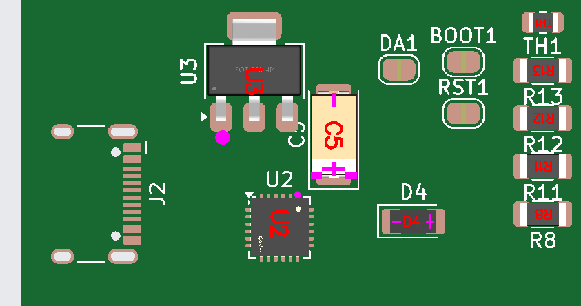

# ESP32 USB demo - KiCad board

Demonstration board based on the **ESP32-WROOM-32E-N4**, with two USB-C ports,
two WCH CH340C USB-to-UART bridges, a 3.3 V regulator, and a TFT SPI display
connector. This directory contains the hardware sources and files used to
prepare JLCPCB assembly.

> **Work in progress, not production-ready.** The saved PCB currently has no
> tracks, vias, or copper zones. Having Gerber, BOM, and CPL files does not
> mean the board is electrically complete or ready to order.
>
> **Connect only one USB cable at a time, even when using the same PC.**
> Both USB VBUS pins are directly tied together. There is no reverse-current
> protection: the unused connector's VBUS contacts are also powered.
> The schematic, PCB footprints, plugin assignments, and generated outputs
> include both interfaces and the cost-reduced parts, but routing is unfinished.

## Overview


*Current two-port component placement, not a routed board.*

| Block | Components and function |
| --- | --- |
| Microcontroller | U1, ESP32-WROOM-32E-N4, Wi-Fi/Bluetooth and 4 MB flash |
| Application USB-C | Serial1 and U2, CH340C connected to ESP32 UART2; R12/R13 are the CC resistors |
| Programming USB-C | FLASHER1 and U4, CH340C connected to UART0; R20/R21 are the CC resistors |
| Automatic programming | Q1/Q2 and R18/R19 translate U4 DTR/RTS into EN/GPIO0 control; C6 provides reset timing |
| Power | Direct common USB VBUS; U3 TLV1117LV33DCYR supplies +3V3; no VBUS-sense divider |
| Display | J1, 8-pin header for a TFT SPI interface |
| Indicators and inputs | D1 RGB LED, D4 green LED, IN1 push button, and TH1 10 kOhm B3950 NTC |
| Configuration | DA1 solder jumper; manual BOOT1/RST1 jumpers and J4 have been removed |

The CH340C is a **USB-to-UART bridge with TTL/CMOS logic levels**, not an
RS-232 transceiver using positive and negative voltages. Do not connect
RS-232 signals directly to the ESP32 or CH340C pins.

### Important connections

U2 remains connected to the `UART2_TX` and `UART2_RX` nets. U4 connects to
`TXD0_ESP` and `RXD0_ESP`. **Use FLASHER1 for programming and the ROM
boot console; Serial1 remains the application's UART2 interface.** UART2 operation
requires the corresponding firmware configuration.

| Pin | J1 - TFT SPI |
| --- | --- |
| 1 | +3V3 |
| 2 | GND |
| 3 | SPI_CS |
| 4 | SPI_RESET |
| 5 | SPI_DC |
| 6 | SPI_SDA, SPI data |
| 7 | SPI_SCK |
| 8 | +3V3 |

These are KiCad pad numbers, not the visual left-to-right order. Check that
the display supports 3.3 V power and logic; `SPI_SDA` is the SPI data net
name here, not an I2C bus.

### Automatic programming through FLASHER1

| U4 CH340C signal | Connection |
| --- | --- |
| TXD, pin 2 | ESP32 GPIO3/U0RXD, net `RXD0_ESP` |
| RXD, pin 3 | ESP32 GPIO1/U0TXD, net `TXD0_ESP` |
| DTR#, pin 13 | R18 to Q1 base; Q2 emitter |
| RTS#, pin 14 | R19 to Q2 base; Q1 emitter |
| Q1 collector | ESP32 EN, net `ESP_EN` |
| Q2 collector | ESP32 GPIO0, net `ESP_BOOT` |

Q1/Q2 use the cross-coupled-emitter auto-reset topology from the
[Espressif ESP32-DevKitC reference schematic](https://dl.espressif.com/dl/schematics/esp32_devkitc_v4-sch-20180607a.pdf).
R18/R19 are 10 kOhm base resistors, the existing R5/R6 provide EN/GPIO0
pull-ups, and C6 adds 1 uF from EN to ground.

| DTR pin level | RTS pin level | EN | GPIO0 |
| --- | --- | --- | --- |
| High | High | High | High |
| Low | Low | High | High |
| High | Low | Low | High |
| Low | High | High | Low |

The table describes physical logic levels, not software Boolean values:
DTR and RTS are active-low. The circuit prevents simultaneous assertion
from holding the ESP32 in reset.

After completing and assembling the PCB, connect FLASHER1 to the PC, select U4's
serial port, and use `esptool` or an IDE configured for its normal DTR/RTS
reset sequence. No manual boot jumper operation should be needed for normal
flashing. R5/R6 remain necessary pull-ups despite removing the manual jumpers.
Use the WCH CH340/CH341 serial driver rather than the Silicon Labs CP210x
driver, and disable terminal RTS/CTS hardware flow control. The ESP32 firmware
and normal `esptool` DTR/RTS reset sequence do not change. The CH340C supports
UART rates up to 2 Mbit/s, which is not the same upper limit as the CP2102N.
Hardware operation still requires validation after assembly.

### CH340C supply and USB connections

**D2/D3 have been removed at the user's request. Connect only one USB cable
at a time.** Either connector powers the shared `+5V` rail directly; the
other connector is then live too. Connecting two cables can backfeed USB
ports, even on the same PC. Both serial interfaces cannot be used over USB
simultaneously with this simplified power arrangement. Respect the host's
USB current limits and check the ESP32/display power budget.

U3 remains **Texas Instruments TLV1117LV33DCYR**, using the pin-compatible
1117 library symbol and SOT-223 footprint. Its maximum operating input is
5.5 V; do not apply higher external voltages. Keep this TI regulator with
C5's low-ESR ceramic capacitor: unlike a generic AMS1117 substitution, it
supports zero-ESR ceramic output capacitors with at least 1 uF effective
capacitance. C5 is now 22 uF / 25 V X5R; allow for DC-bias and temperature
derating. See the [TI regulator specifications](https://www.ti.com/product/TLV1117LV).

Both bridges now use **CH340C, C84681**, not pin-compatible CP2102N replacements.
The schematic pinout and actual PCB footprints have been changed to SOP-16,
`Package_SO:SOIC-16_3.9x9.9mm_P1.27mm`. Both bridges were repositioned to
accommodate the larger packages. C8/C9 were moved near the bridge supply pins;
C5 was moved slightly to clear the new layout.

| CH340C pin, both U2/U4 | Connection |
| --- | --- |
| 16, VCC and 4, V3 | Both tied to external regulated +3V3 |
| 1, GND | Ground |
| 15, R232 | Ground, normal non-inverted TTL UART mode |
| 5, UD+ and 6, UD- | Respective connector's D+ and D- |
| 7 and 8 | Unconnected; no crystal or optional OUT# function used |
| 9-12, unused modem inputs | Unconnected, as permitted by the datasheet |
| 13/14, DTR#/RTS# | U4 drives the auto-reset circuit; unused on U2 |

This is the manufacturer's **external 3.3 V supply mode**: do not feed VCC
with 5 V while retaining the V3-to-VCC connection. It keeps UART/control
outputs at ESP32-safe 3.3 V levels. C9 provides U2's local 100 nF bypass;
C8 provides U4's local 100 nF bypass, with C7 as additional 4.7 uF bulk
decoupling. Route these connections with a short return to ground.

CH340C includes its clock and power-on reset, and has no separate VBUS-sense
input. The former CP2102N reset pull-ups R7/R22 and sensing divider R14/R15
are removed. Both bridges remain powered with either single cable connected;
there is no independent cable-presence detection.
See the [WCH CH340 datasheet, sections 4 and 5.1](https://www.lcdwiki.com/res/PublicFile/CH340C_en.pdf).

C10 provides 1 uF on FLASHER1 VBUS. Both connectors' D+ (A6/B6) connect
directly to their bridge's pin 5, and D- (A7/B7) to pin 6, using
`USB_DATA_DP` / `USB_DATA_DM` and `USB_PROG_DP` / `USB_PROG_DM`.
No external series USB data resistors or pull-up are required.
No external USB data-line ESD protection
array is fitted; removing it reduces protection against electrostatic
discharge at the connector. Route the USB pair appropriately during PCB layout.

## Schematic and files

[](images/board.svg)

*Open the image to zoom in. The KiCad sources remain the authoritative files
to edit and verify.*

| Path | Contents |
| --- | --- |
| `board.kicad_pro` | KiCad project to open |
| `board.kicad_sch` | Schematic |
| `board.kicad_pcb` | PCB layout |
| `esp32_usb.kicad_sym`, `sym-lib-table` | Project CH340C symbol for external 3.3 V supply mode |
| `images/` | Images used by this README |
| `jlcpcb/project.db` | JLCPCB plugin assignments and local corrections |
| `jlcpcb/gerber/` | Exported Gerber and drill files |
| `jlcpcb/production_files/` | Gerber archive, BOM, and CPL to upload to JLCPCB |

The files were edited using **KiCad 10**. Install the standard symbol and
footprint libraries; the schematic also contains embedded symbols originating
from `PCM_JLCPCB-Extended`. Both USB connectors use the standard footprint
`Connector_USB:USB_C_Receptacle_HCTL_HC-TYPE-C-16P-01A`.

The local `ESP32_USB:CH340C_3V3` symbol is derived from KiCad's standard
CH340C symbol, with V3 represented as a power input for the selected 3.3 V
mode. This avoids treating an externally driven V3 input as a regulator
output in ERC. Keep both local-library files with the project.

The generated `jlcpcb/gerber/` and `jlcpcb/production_files/` directories are
ignored by Git. Regenerate them from the current sources before uploading.
Keep `jlcpcb/project.db` and the documentation images under version control.
Local editor history, lock files, autosaves, and KiCad per-user settings
(`*.kicad_prl`) are also ignored.

## Required KiCad plugin for JLCPCB

Use **[bouni/kicad-jlcpcb-tools](https://github.com/bouni/kicad-jlcpcb-tools)**,
shown in KiCad as **JLCPCB Tools**. It assigns LCSC/JLCPCB part numbers to
components and generates Gerber, Excellon, BOM, and CPL files.
Do not confuse it with *Fabrication Toolkit*: these are different plugins
and may apply different orientation corrections.

### Installation

1. In the main KiCad project manager, open **Plugin and Content Manager**,
   then open the repository manager.
2. Add the repository provided by the plugin author:

   ```text
   https://raw.githubusercontent.com/Bouni/bouni-kicad-repository/main/repository.json
   ```

3. Install **KiCad JLCPCB tools** from the added repository.
4. Restart the PCB Editor or refresh its plugins, then open
   **Tools > External Plugins > JLCPCB Tools**.

For updates, requirements, and interface changes, see the
[official plugin documentation](https://github.com/bouni/kicad-jlcpcb-tools#installation-).

### Main catalog assignments

| Reference | Manufacturer part number | JLCPCB | Notes |
| --- | --- | --- | --- |
| U1 | ESP32-WROOM-32E-N4 | [C701341](https://jlcpcb.com/partdetail/C701341) | ESP32 module |
| U2, U4 | CH340C | [C84681](https://jlcpcb.com/partdetail/C84681) | WCH SOP-16, crystal-less, external 3.3 V supply |
| U3 | TLV1117LV33DCYR | [C15578](https://jlcpcb.com/partdetail/C15578) | Ceramic-stable TI 3.3 V regulator |
| C3, C7 | 1206B475K500NT | [C29823](https://jlcpcb.com/partdetail/C29823) | Basic, 4.7 uF / 50 V X7R, 1206 |
| C4, C6, C10 | CL31B105KBHNNNE | [C1848](https://jlcpcb.com/partdetail/C1848) | Basic, 1 uF / 50 V X7R, 1206 |
| C5 | CL31A226KAHNNNE | [C12891](https://jlcpcb.com/partdetail/C12891) | Basic, nonpolar ceramic, 22 uF / 25 V X5R, 1206 |
| R12, R13, R20, R21 | 0603WAF5101T5E | [C23186](https://jlcpcb.com/partdetail/C23186) | Basic, 5.1 kOhm 1%, 0603 USB CC pull-downs |
| D4 | KT-0805G | [C2297](https://jlcpcb.com/partdetail/C2297) | Basic green indicator, 0805; unchanged series resistor, brightness may differ |
| Serial1, FLASHER1 | HC-TYPE-C-16P-01A | [C2894897](https://jlcpcb.com/partdetail/C2894897) | HCTL USB-C connectors with matching footprints |
| Q1, Q2 | MMBT3904(RANGE:100-300) | [C20526](https://jlcpcb.com/partdetail/C20526) | SOT-23 NPN transistors; base/emitter/collector pins 1/2/3 |

Recheck stock and pricing in the catalog before ordering. See the regenerated
BOM for the complete component list. Assignments are synchronized in the
schematic, PCB, and plugin database. J1 has no assigned LCSC part and is not
included in the priced BOM; source and assemble that header separately.

### Cost reduction for five assembled boards

The comparison uses the installed JLCPCB catalog snapshot (817,063 entries),
not a live checkout quote. Prices below use the applicable quantity tier
for five boards, including ten CH340C devices in the current revision.

| Item | Original BOM | Basic-parts revision | Current CH340C revision |
| --- | --- | --- | --- |
| Components for five boards, USD | 49.59 | 46.39 | 32.75 |
| Distinct Extended part codes | 13 | 6 | 6 |
| Nominal Extended loading fees at USD 3/code | 39.00 | 18.00 | 18.00 |
| Components plus these loading fees, USD | 88.59 | 64.39 | 50.75 |

Indicative total saving: **USD 37.84 per five-board order**, or approximately
**USD 7.57 per board**. The CH340C change alone saves USD 13.64 versus the
Basic-parts revision: ten bridges cost USD 4.56 instead of USD 18.09,
and four obsolete resistors are removed (USD 0.11 per order).
Both old and new bridge codes are Extended, so replacing both bridges
with the same CH340C code leaves the feeder-code count unchanged.
The earlier optimization converted seven Extended codes to Basic. Some Basic
capacitors have a slightly higher unit price but avoid an extra feeder code.
Actual fees depend on assembly service, Preferred Extended exemptions,
coupons, inventory, and required spare quantities. PCB fabrication, assembly
setup, placement charges, shipping, taxes, and the unassigned J1 are excluded.
See [JLCPCB's assembly fee explanation](https://jlcpcb.com/help/article/pcb-assembly-faqs).

C5 changes from polarized tantalum 6032 to nonpolar ceramic 1206.
The CC resistors change from 1206 to 0603, and D4 from 1206 to 0805;
their actual PCB footprints are updated, not just BOM descriptions.
The unchanged Basic passives, MMBT3904 transistors, and push button already
avoid Extended loading fees.

The ESP32 module now represents USD 18.84 of the USD 32.75 component estimate
for five boards. The already inexpensive USB-C connectors, RGB LED,
NTC calibration characteristics, and TI regulator are retained where
no sufficiently verified, worthwhile compatible substitution was established.

### Export and upload workflow

1. Save the schematic and PCB, update the PCB from the schematic when needed,
   and complete routing.
2. Run ERC and DRC, including schematic-to-PCB parity checks. Resolve errors
   before preparing an order.
3. Open JLCPCB Tools and check LCSC assignments, footprints, BOM/CPL exclusions,
   and local corrections. Do not assume that changing a schematic field
   automatically updates every assignment already stored in the database.
4. Generate all files using the same plugin and the same PCB revision.
5. Upload these files from `jlcpcb/production_files/` to JLCPCB:

   | File | Purpose |
   | --- | --- |
   | `GERBER-board.zip` | Copper, masks, silkscreens, board outline, and drills |
   | `BOM-board.csv` | Components and LCSC part numbers to purchase/assemble |
   | `CPL-board.csv` | Placement coordinates, rotation, and assembly side |

6. Inspect the assembly preview: centering, side, rotation, IC pin 1, and
   capacitor/LED polarity.

Do not mix Gerbers from one revision with a BOM or CPL from another, or use
an old `production` export instead of newly generated files.
Negative Y coordinates in the CPL do not, on their own, indicate an error:
they must be consistent with the origin used in the Gerbers.

## Bridge orientation and historical CP2102N correction



*Historical screenshot of the removed CP2102N, not the current CH340C design
or an approved assembly.*

The old exact-value `^CP2102N-A02-GQFN24R$` zero-degree rule is retained
in `jlcpcb/project.db` for history but **does not match CH340C**.
The current SOP-16 bridges use the existing `^SOIC-` correction of
270 degrees. With each footprint at 0 degrees, both CPL entries export
270 degrees. This is the plugin's package correction, not a physical
rotation of the PCB footprints.

**Confirm both CH340C pin-1 and lead alignment in JLCPCB's new assembly
preview before ordering.** The previous CP2102N screenshot cannot validate
the replacement's orientation; no CH340C preview has been approved.
The standard SOIC-16 footprint marks pin 1 at the upper left at 0 degrees.
Do not copy the old QFN override to the new part without preview evidence.

**Keep `project.db` with the sources.** In this plugin version, a local
correction table replaces the global table rather than extending it.
Other global rules were copied into the local database to retain their
behavior. Recheck corrections after plugin updates or component changes.

### Q1/Q2 MMBT3904 placement correction

The generic `^SOT-23` rule applied a -90-degree correction to Q1/Q2,
exporting 270 degrees for footprints placed at 0 degrees. A local
`^MMBT3904$` rule with a **180-degree correction and zero X/Y offsets** now
overrides that generic rule for the current C20526 assignments. Q1/Q2
therefore export at 180 degrees in `jlcpcb/production_files/CPL-board.csv`.
The initial 0-degree override was incorrect: the subsequent JLCPCB preview
showed the model's single lead on the left while the footprint's single
collector pad (pin 3) is on the right. The 180-degree correction addresses
that inversion; it does not rotate the physical PCB footprints.

The rule is saved in `jlcpcb/project.db` and survives subsequent exports.
Other SOT-23 devices and their corrections are unchanged. This matches the
exact component value, not its reference or LCSC field: recheck the rule
if the value, assigned part, or footprint changes. Upload the updated CPL
and confirm both transistors' lead alignment in JLCPCB's preview; the
updated preview has not yet been confirmed.

## Open issues before fabrication

- **Placement is not completed hardware:** schematic/PCB parity is reconciled,
  but electrical routing and manufacturing corrections remain necessary.
- **Routing is missing:** the saved PCB has no tracks, vias, or zones;
  the last check reported 112 unconnected items.
- **Serial1 / FLASHER1:** the HCTL footprints have four hole-to-copper clearance
  violations of approximately 0.185 mm against the project's 0.25 mm limit.
  Resolve the geometry or confirm manufacturability with the fabricator;
  do not lower the limit merely to hide the error.
- **U1:** the last DRC reported 0.2 mm holes below the project's 0.3 mm
  minimum; verify the footprint and manufacturing process.
- **Silkscreen and assembly:** overlaps remain to be resolved, and both
  CH340C orientations must be confirmed in the JLCPCB preview.

These notes describe the documented state as of **November 4, 2026**.
The images are snapshots: regenerate them after source changes and update
this section before distributing production files.
