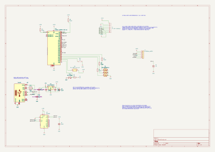

# ESP32 USB demo - KiCad board

ESP32-WROOM-32E-N4 demonstration board with one USB-C port, a WCH CH340C
application USB-to-UART bridge, external UART0 programming headers, a 3.3 V
regulator, and a TFT SPI connector.

> **Work in progress, not production-ready.** The PCB has no tracks, vias,
> or copper zones. Exported Gerber, BOM, and CPL files are placement snapshots,
> not a finished board suitable for ordering. Complete routing and resolve
> manufacturing issues before fabrication.
>
> **Connect either the external programmer or Serial1 USB, never both.**
> During programming, the programmer supplies regulated 3.3 V through J4.
> Disconnect the programmer completely before connecting Serial1 USB.
> UART signals must use 3.3 V logic, never 5 V or RS-232 voltages.

## Overview


*Component placement, not a routed board.*

| Block | Components and function |
| --- | --- |
| Microcontroller | U1, ESP32-WROOM-32E-N4, Wi-Fi/Bluetooth and 4 MB flash |
| Application USB-C | Serial1 and U2 CH340C, connected to ESP32 UART2; R12/R13 are the USB-C CC pull-downs |
| External programming | J4 exposes UART0, EN/reset, GPIO0/BOOT, ground and the common +3V3 rail |
| Manual boot/reset | Use J4 pin 6 (GPIO0), pin 5 (EN) and pin 2 (GND); no separate BOOT/RESET headers |
| Boot/reset bias | R5/R6, 10 kOhm EN/GPIO0 pull-ups; C6, 1 uF EN-to-ground reset timing |
| Power | U3 USB regulator output and J4 pin 1 share +3V3 directly; no source selector or reverse-current isolation |
| Display | J1, 8-pin TFT SPI header |
| Indicators and inputs | D1 RGB LED, IN1 push button, TH1 10 kOhm B3950 NTC |
| Configuration | DA1 solder jumper |

The second programming USB connector FLASHER1, its CH340C U4, automatic-reset
transistors Q1/Q2, and associated R18/R19/R20/R21/C7/C8/C10 have been removed.
Serial1 remains the **application UART2 interface**, not the ESP32 ROM
programming interface. UART2 requires matching firmware configuration.
There is no on-board DTR/RTS auto-reset circuit in this revision.

The independent [`board_cp2102n` project](../board_cp2102n/README.md) has not
been changed: it retains two CP2102N bridges, two USB-C connectors, and
automatic programming. The two projects therefore no longer differ only
in bridge choice; account for these functional differences when comparing
JLCPCB quotations.

## External programming

J4 uses a six-pin, through-hole, 2.54 mm vertical header. The table gives
**KiCad pad numbers**, not an assumed left-to-right connector view; pad 1
is square. Board labels TX/RX refer to the ESP32, not the adapter.

| J4 pin | Signal | External adapter connection |
| --- | --- | --- |
| 1 | +3V3, common board rail | Programmer's regulated 3.3 V output; Serial1 USB must be disconnected |
| 2 | GND | Adapter GND |
| 3 | TXD0_ESP, GPIO1/U0TXD | Adapter RX input |
| 4 | RXD0_ESP, GPIO3/U0RXD | Adapter TX output |
| 5 | ESP_EN, reset | Briefly connect to pin 2 (GND), then release to reset |
| 6 | ESP_BOOT, GPIO0 | Connect to pin 2 (GND) during reset to enter download mode |

J4 pin 1, U3's output and the board loads are directly connected to the same
`+3V3` rail. No power-selection jumper is required. This arrangement assumes
physically exclusive connections: unplug Serial1 USB for programming, then
disconnect the programmer completely before using Serial1 USB.

BOOT and RESET are operated directly through J4; separate BOOT1/RST1 headers
are not fitted. Use temporary leads to GND as described below; do not keep EN
grounded during flashing or normal operation.
R5/R6 remain necessary even without auto-reset: they establish the normal
high levels of EN and GPIO0. C6 remains connected between EN and GND.

### Manual flashing sequence

1. Make sure Serial1 USB is disconnected and all power is off.
2. Connect a regulated **3.3 V supply** to J4 pin 1 and GND to pin 2.
   The supply must support the ESP32's current peaks and other board loads;
   many USB-to-UART adapter 3.3 V outputs are not rated for this load.
   Connect a 3.3 V logic USB-to-UART adapter's GND, RX and TX as shown above.
   Use a common ground. Do not connect Serial1 USB while the programmer is connected.
3. Connect J4 pin 6 to pin 2 (GND) to pull GPIO0 low.
4. Briefly connect J4 pin 5 to GND, then release it while keeping GPIO0 low. The ESP32
   enters its ROM serial download mode when EN rises.
5. Select the **external adapter's** serial port in `esptool` or the IDE,
   not Serial1/U2. Use manual boot/reset handling rather than expecting an
   on-board DTR/RTS reset circuit. Disable RTS/CTS hardware flow control.
6. After flashing, release GPIO0 and disconnect the programmer and any external
   supply completely. Connect Serial1 USB to run the application.

For normal USB operation, leave J4 GPIO0 and EN released.
EN and GPIO0 are exposed
for a suitable external programming circuit, but **do not directly wire
adapter DTR/RTS to them** without a correctly designed ESP32 reset circuit.
The adapter's driver depends on its bridge; the on-board U2 uses the WCH
CH340/CH341 driver.

### TFT SPI pinout

| J1 pin | Signal |
| --- | --- |
| 1 | +3V3 |
| 2 | GND |
| 3 | SPI_CS |
| 4 | SPI_RESET |
| 5 | SPI_DC |
| 6 | SPI_SDA, SPI data |
| 7 | SPI_SCK |
| 8 | +3V3 |

Check that the display accepts 3.3 V power and logic. `SPI_SDA` is the
SPI data net name here, not an I2C connection.

## CH340C, USB and power

U2 uses CH340C, **C84681**, in
`Package_SO:SOIC-16_3.9x9.9mm_P1.27mm`. It is not pin-compatible with
CP2102N. Its application UART operates at ESP32-safe 3.3 V logic levels.

| U2 pin | Connection |
| --- | --- |
| 16, VCC and 4, V3 | Both tied to regulated +3V3 |
| 1, GND and 15, R232 | Ground; normal non-inverted TTL UART mode |
| 5, UD+ and 6, UD- | Serial1 D+ and D-, respectively |
| 2, TXD and 3, RXD | Application UART2, with TX/RX crossed to the ESP32 |
| 7-14 | Unused clock/OUT/modem/control pins |

This is the manufacturer's **external 3.3 V supply mode**. Do not apply
5 V to VCC while V3 remains tied to it. C9 supplies local 100 nF bypass
decoupling; route its ground return and the bridge supply connections short.
CH340C has an internal clock and power-on reset, and no VBUS-sense input.
The former CP2102N reset pull-ups R7/R22 and sensing divider R14/R15
are absent. See the [WCH CH340 datasheet](https://www.lcdwiki.com/res/PublicFile/CH340C_en.pdf).

Serial1 D+ (A6/B6) and D- (A7/B7) connect directly to U2 pins 5 and 6.
No external series USB resistors or USB pull-up are required. There is no
external USB data-line ESD array, reducing protection against connector
electrostatic discharge. Route the differential pair appropriately.
With only one board USB connector, the former dual-VBUS power-sharing
restriction no longer applies to this project. Respect USB host current
limits and the ESP32/display power budget.

U3 remains **TI TLV1117LV33DCYR**, with the pin-compatible 1117 symbol and
SOT-223 footprint. Its maximum operating input is 5.5 V. Keep this
ceramic-stable TI regulator rather than substituting a generic AMS1117
without checking stability. C5 is nonpolar 22 uF / 25 V X5R ceramic 1206;
allow for DC-bias/temperature derating and retain at least the regulator's
required effective capacitance. During external programming, U3's OUT remains
connected to +3V3 while its USB input is floating. Its internal body diode
can charge the input capacitors and raise the disconnected VBUS rail below
the external 3.3 V supply. There is no reverse-current isolation; verify the
startup transient on assembled hardware, especially if adding VBUS loads.
TI documents that reverse current is not internally limited; see the
[TLV1117LV datasheet, section 7.3.1](https://www.ti.com/lit/ds/symlink/tlv1117lv.pdf).

## Schematic and files

[](images/board.svg)

*Open the image to zoom in. KiCad sources are authoritative.*

| Path | Contents |
| --- | --- |
| `board.kicad_pro` | KiCad project to open |
| `board.kicad_sch` | Schematic |
| `board.kicad_pcb` | Unrouted PCB placement |
| `esp32_usb.kicad_sym`, `sym-lib-table` | Project CH340C symbol for external 3.3 V supply mode |
| `images/` | README schematic and PCB snapshots |
| `jlcpcb/project.db` | Plugin assignments, export exclusions and local corrections |
| `jlcpcb/gerber/` | Generated Gerber and drill files |
| `jlcpcb/production_files/` | Generated Gerber archive, BOM and CPL |

Sources use **KiCad 10**. Install standard symbol and footprint libraries;
the schematic also embeds a connector symbol originating from
`PCM_JLCPCB-Extended`. Serial1 uses
`Connector_USB:USB_C_Receptacle_HCTL_HC-TYPE-C-16P-01A`.
The local `ESP32_USB:CH340C_3V3` symbol represents V3 as a power input,
matching external 3.3 V operation and avoiding a false ERC power-output
conflict. Keep both local-library files with the project.

Generated `jlcpcb/gerber/` and `jlcpcb/production_files/` directories are
ignored by Git. Regenerate from current sources before uploading. Keep
the plugin database and documentation images under version control.
Editor history, lock files, autosaves and `*.kicad_prl` are also ignored.

## Required KiCad plugin for JLCPCB

Use **[bouni/kicad-jlcpcb-tools](https://github.com/bouni/kicad-jlcpcb-tools)**,
shown in KiCad as **JLCPCB Tools**. It assigns LCSC/JLCPCB parts and generates
Gerber, Excellon, BOM and CPL files. *Fabrication Toolkit* is a different
plugin and may apply different rotation corrections.

### Installation

1. Open KiCad's **Plugin and Content Manager**, then its repository manager.
2. Add the author's repository:

   ```text
   https://raw.githubusercontent.com/Bouni/bouni-kicad-repository/main/repository.json
   ```

3. Install **KiCad JLCPCB tools**, then restart the PCB Editor or refresh plugins.
4. Open **Tools > External Plugins > JLCPCB Tools**.

See the [official installation documentation](https://github.com/bouni/kicad-jlcpcb-tools#installation-)
for current requirements and interface changes.

### Main catalog assignments

| Reference | Manufacturer part | JLCPCB | Notes |
| --- | --- | --- | --- |
| U1 | ESP32-WROOM-32E-N4 | [C701341](https://jlcpcb.com/partdetail/C701341) | ESP32 module |
| U2 | CH340C | [C84681](https://jlcpcb.com/partdetail/C84681) | WCH SOP-16, internal clock |
| U3 | TLV1117LV33DCYR | [C15578](https://jlcpcb.com/partdetail/C15578) | Ceramic-stable TI regulator |
| C3 | 1206B475K500NT | [C29823](https://jlcpcb.com/partdetail/C29823) | Basic, 4.7 uF / 50 V X7R, 1206 |
| C4, C6 | CL31B105KBHNNNE | [C1848](https://jlcpcb.com/partdetail/C1848) | Basic, 1 uF / 50 V X7R, 1206 |
| C5 | CL31A226KAHNNNE | [C12891](https://jlcpcb.com/partdetail/C12891) | Basic, nonpolar 22 uF / 25 V X5R, 1206 |
| R12, R13 | 0603WAF5101T5E | [C23186](https://jlcpcb.com/partdetail/C23186) | Basic, 5.1 kOhm 1%, USB CC pull-downs |
| Serial1 | HC-TYPE-C-16P-01A | [C2894897](https://jlcpcb.com/partdetail/C2894897) | HCTL USB-C, matching footprint |
| J1, J4 | Standard 2.54 mm pin headers | Unassigned | Source and assemble manually |

J4 remains in the schematic and PCB but is **excluded from both BOM and CPL**
because it is manually assembled and has no assigned LCSC part. This prevents
JLCPCB reporting a BOM designator missing from the CPL. Source manual headers
separately, or deliberately select compatible catalog parts and a supported
through-hole assembly service before changing exclusions.

Existing cost-reduced Basic passive assignments are retained. The previous
dual-CH340C component estimate of USD 32.75 for five boards is **historical,
not the current BOM total**. This revision removes eleven components per
board and adds three manually assembled headers. Five remaining CH340C
devices use a different catalog quantity tier than ten devices: in the
previous snapshot, USD 0.546 instead of USD 0.456 each.
Removing one of two identical bridges does not remove its feeder code.
Compare freshly uploaded BOMs for actual component, assembly, feeder and
possible QFN X-ray charges; header/shunt sourcing, shipping and taxes are
additional. See [JLCPCB assembly pricing](https://jlcpcb.com/help/article/pcb-assembly-price).

### Export and upload

1. Save sources, update PCB from schematic as needed, and finish routing.
2. Run ERC and DRC, including schematic parity, and resolve errors.
3. Open JLCPCB Tools; check assignments, footprints, BOM/CPL exclusions and
   local corrections. Schematic fields alone may not update stored assignments.
4. Generate all outputs from the same PCB revision and plugin.
5. Upload `GERBER-board.zip`, `BOM-board.csv` and `CPL-board.csv` from
   `jlcpcb/production_files/`.
6. Inspect centering, assembly side, IC pin 1, lead alignment and LED polarity
   in JLCPCB's preview. Verify that removed programming components are absent.

Do not mix versions or upload old `production` exports. Negative CPL Y
coordinates are not inherently incorrect; they must match the Gerber origin.

### D1 RGB LED placement correction

The [ROHM SMLVN6RGB1U1 datasheet, Figure 1](https://fscdn.rohm.com/en/products/databook/datasheet/opto/led/chip_multi/smlvn6rgb1u1-e.pdf)
places the anode index at the upper-left corner in top view: pins 1/2/3 are
the blue/red/green anodes on the left, and pins 6/5/4 are their cathodes on
the right. The KiCad footprint and schematic use this mapping correctly.

The supplied JLCPCB preview with the original 0-degree CPL placed the
orientation marker at the opposite, lower-right corner. The local exact-value
rule `^SMLVN6RGB1U1$` therefore applies **180 degrees with zero X/Y offsets**.
D1 remains at 0 degrees in KiCad and exports at 180 degrees in the CPL.
This is an assembly-export correction, not a change to the physical footprint
or electrical connections. Re-upload the regenerated CPL and confirm the
model's anode index aligns with the upper-left pin-1 mark before ordering.
The corrected JLCPCB preview has not yet been confirmed.

### U2 placement correction

U2 retains the existing `^SOIC-` **270-degree package correction**. At its
0-degree PCB orientation, the CPL exports 270 degrees. This changes export
orientation, not the footprint's physical placement. Confirm CH340C pin 1
and lead alignment in the JLCPCB preview; the old CP2102N preview cannot
validate the current SOP-16 device.

The historical exact-value CP2102N and MMBT3904 rules remain in
`project.db`, but no current component matches them. Q1/Q2 are removed.
Keep the database: in this plugin version, local rules **replace**, rather
than extend, the global correction table. Global rules were copied locally
to preserve other packages' behavior. Recheck after updates or part changes.

## Open issues before fabrication

- **Routing is missing:** no tracks, vias or zones; unconnected pads remain.
- **Serial1:** existing HCTL hole-to-copper clearances are approximately
  0.185 mm against the project's 0.25 mm minimum. Correct geometry or confirm
  manufacturing requirements; do not lower constraints just to hide errors.
- **U1:** footprint 0.2 mm holes are below the project's 0.3 mm drill minimum;
  verify footprint/process requirements.
- **Silkscreen and assembly:** existing overlaps remain; confirm U2
  orientation in the assembly preview.
- **Schematic libraries:** existing embedded-symbol/library warnings and
  unused ESP32 GPIO findings remain to be resolved or explicitly reviewed.

The images and local outputs reflect the external-programming revision.
Regenerate them after further source changes.
