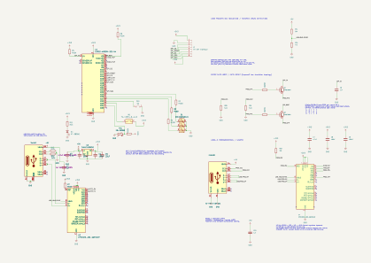

# ESP32 USB demo - CP2102N comparison variant

This is an independent version of the [CH340C board](../board/README.md).
It uses **two CP2102N-A02-GQFN24R bridges, JLCPCB C969151**, instead of the
two CH340C devices. The ESP32-WROOM-32E-N4, application connections, two
USB-C connectors, TFT interface, indicators, inputs, regulator and
cost-reduced passive parts are otherwise retained.

> **Placement-only design, not ready for fabrication.** Like the CH340C
> version, this PCB has no tracks, vias or copper zones. Generated files
> allow a preliminary assembly-price comparison, not a production order.
>
> **Connect only one USB cable at a time, even on the same PC.** Both
> connectors' VBUS contacts are directly tied to +5V, without isolation or
> reverse-current protection. The unused connector is also powered.

## Projects and JLCPCB files

| Version | Project to open | Manufacturing directory |
| --- | --- | --- |
| CH340C, unchanged original | `..\board\board.kicad_pro` | `..\board\jlcpcb\production_files\` |
| CP2102N, this variant | `board.kicad_pro` | `jlcpcb\production_files\` |

Each project has its own schematic, PCB and **`jlcpcb\project.db`**.
Both use **KiCad 10** and the
**[bouni/kicad-jlcpcb-tools](https://github.com/bouni/kicad-jlcpcb-tools)**
plugin, shown as JLCPCB Tools. See the original board's
[plugin installation instructions](../board/README.md#required-kicad-plugin-for-jlcpcb).

For each version, upload the following three files from that version's
manufacturing directory to a separate JLCPCB quote:

| File | Purpose |
| --- | --- |
| `GERBER-board.zip` | Board fabrication data and drills |
| `BOM-board.csv` | Assembly components and LCSC part numbers |
| `CPL-board.csv` | Component placement and rotation |

**The filenames are deliberately the same because each project is named
`board`, but the directories and contents are different. Do not mix them.**
CH340C and CP2102N are not pin-compatible; selecting another part in the
JLCPCB BOM editor cannot convert one PCB into the other.

Use the same PCB quantity, assembly quantity, PCB options, assembly service,
shipping destination and coupons when comparing. Confirm the matched
bridge code is **C84681 for CH340C** or **C969151 for CP2102N**.
J1 still has no LCSC assignment; it is not included in the priced component
estimate and must be sourced/assembled separately or explicitly assigned.

After any source change, save the project, update PCB connectivity and
regenerate all manufacturing files with JLCPCB Tools for that project.
The manufacturing directories are ignored by Git; the per-project database
and documentation images remain versioned.

## Schematic and placement

The PCB outline and unrelated component placements are retained from the
current CH340C board. U2/U4 use their matching QFN footprints and placements;
C8/C9 return to the CP2102N bypass arrangement, and four supporting resistors
are added. Both versions still need final placement optimization and routing.

## Circuit differences

| Item | CH340C version | CP2102N version |
| --- | --- | --- |
| U2 and U4 | CH340C, C84681 | CP2102N-A02-GQFN24R, C969151 |
| Footprint | SOIC-16, 3.9 x 9.9 mm, 1.27 mm pitch | QFN-24 plus exposed pad, 4 x 4 mm, 0.5 mm pitch |
| Supply | VCC16 and V3-4 tied to +3V3 | VIO5, VDD6 and VREGIN7 tied to +3V3 |
| USB D+ / D- | Pins 5 / 6 | Pins 3 / 4 |
| TXD / RXD | Pins 2 / 3 | Pins 21 / 20 |
| U4 DTR / RTS | Pins 13 / 14 | Pins 23 / 19 |
| Reset pull-ups | Not needed | R7 for U2 and R22 for U4, 10 kOhm, C17902 |
| VBUS detection | No separate sense input | R14 22 kOhm / R15 47 kOhm, C31850 / C25819 |
| Host driver family | WCH CH340/CH341 | Silicon Labs CP210x |

The CP2102N internal regulators are bypassed: both bridges use the common
external regulated 3.3 V rail on VREGIN, VDD and VIO. Do not change this
to parallel internal regulator outputs. U3 remains the ceramic-stable TI
TLV1117LV33DCYR with the nonpolar 22 uF / 25 V ceramic C5.

R14/R15 form one shared VBUS divider feeding both pin-8 inputs through
`USB_VBUS_SENSE`. The ratio is approximately 0.6812, producing about 3.41 V
at 5 V USB input. Never connect +5V directly to the sense inputs.
Both bridges detect the common supply, not the presence of their individual
cable. See the
[Silicon Labs VBUS-divider requirement](https://community.silabs.com/s/article/cp2102n-requires-a-voltage-divider-on-vbus).

USB D+ and D- connect directly between each receptacle and its bridge.
No external USB data-line ESD array is fitted, matching the original
board's requested protection level.

### UART functions and automatic programming

**Serial1/U2 remains the application's UART2 interface. FLASHER1/U4 remains
the programming and ROM-console interface on UART0.** No ESP32-S3 migration
or application pin reassignment is included.

| Signal | CP2102N connection |
| --- | --- |
| U2 TXD21 | `UART2_RX`, ESP32 GPIO16 |
| U2 RXD20 | `UART2_TX`, ESP32 GPIO17 |
| U4 TXD21 | `RXD0_ESP`, ESP32 GPIO3/U0RXD |
| U4 RXD20 | `TXD0_ESP`, ESP32 GPIO1/U0TXD |
| U4 DTR23 | R18 to Q1 base; Q2 emitter |
| U4 RTS19 | R19 to Q2 base; Q1 emitter |
| Q1 collector | `ESP_EN` |
| Q2 collector | `ESP_BOOT`, GPIO0 |

Q1/Q2 retain the cross-coupled-emitter automatic boot/reset circuit,
R18/R19 base resistors, R5/R6 EN/GPIO0 pull-ups and C6 reset timing.
Use normal `esptool` DTR/RTS flashing and disable terminal RTS/CTS
hardware flow control. Manual BOOT1/RST1 jumpers and J4 are not restored.
Use the Silicon Labs CP210x driver for this version rather than WCH's driver.

## Indicative price comparison: five assembled boards

These are component estimates from the installed JLCPCB catalog snapshot,
using the applicable purchase quantities. They are **not live quotes** and
exclude spare quantities, assembly, PCB fabrication, shipping and taxes.

| Item | CH340C | CP2102N | CP2102N increase |
| --- | --- | --- | --- |
| Ten bridge ICs | USD 4.56 | USD 18.09 | USD 13.53 |
| Additional reset/divider resistors for five boards | None | USD 0.11 | USD 0.11 |
| Complete priced BOM for five boards | USD 32.75 | USD 46.39 | **USD 13.64** |
| Priced BOM per board | USD 6.55 | USD 9.28 | **About USD 2.73** |
| Distinct Extended codes | 6 | 6 | No change |
| Distinct populated catalog codes | 17 | 19 | Two extra Basic resistor codes |

Both bridge types are Extended. Replacing the same bridge code twice does
not add two Extended feeder codes. In Economic assembly, ordinary Basic
codes do not normally incur an Extended loading fee; Preferred exemptions
and current catalog classifications still need confirmation. Standard
assembly charges feeder loading for Basic codes too, so the two added
resistor codes can affect its quote.

CP2102N also adds approximately 26 nominal solder contacts per board
(two 25-contact QFN packages instead of two 16-contact SOIC packages, plus
four two-contact resistors). Package-pad accounting and the exposed-pad
implementation can change the invoiced count. More importantly, the QFN
packages may introduce additional X-ray inspection charges. Setup, stencil,
service eligibility, minimum charges and inspections must be compared in
the actual JLCPCB breakdown, not inferred from component prices.
See [JLCPCB's assembly fee explanation](https://jlcpcb.com/help/article/pcb-assembly-price).

A higher price does not by itself establish better reliability. Both
versions require correct layout, decoupling and USB signal integrity.
Compare driver behavior, operating-system compatibility, required baud
rates and repeated flashing on the assembled prototypes before deciding
whether the CP2102N premium is worthwhile.

## Placement corrections

This version's **own** `jlcpcb\project.db` retains all existing package
correction rules, including:

| Exact value pattern | Rotation correction | X/Y offset |
| --- | --- | --- |
| `^CP2102N-A02-GQFN24R$` | 0 degrees | 0 / 0 mm |
| `^MMBT3904$` | 180 degrees | 0 / 0 mm |

With the current physical orientations, U2/U4 export at **0 degrees** and
Q1/Q2 at **180 degrees**. The CH340C variant's SOP-16 package correction
must not be applied to these QFN parts. Keep the two databases separate.
Confirm IC pin 1, all transistor leads and component polarity in each
JLCPCB preview; neither variant's preview is an assembly approval.

## Remaining work before an order

- Complete routing: this version has zero tracks/vias/zones and 123
  unconnected items in the current DRC report.
- Resolve the existing HCTL connector hole-clearance and ESP32 module
  minimum-drill findings, plus silkscreen overlaps.
- Resolve the existing schematic ERC findings: four unconnected ESP32
  GPIOs and the USB-connector/LED symbol-library warnings.
- Check bypass placement and returns during routing, verify the power
  budget, and confirm the new assembly preview before ordering.

The schematic and PCB connectivity are reconciled. This comparison variant
does not claim that the unfinished design is production-ready.
