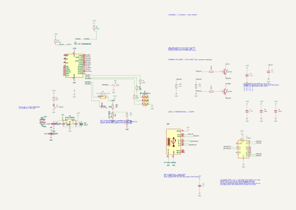

# ESP8266 + CH340B USB board

Independent KiCad 10 project using an **ESP-12F** and a **CH340B** USB-to-UART
bridge. The ESP8266 + CP2102N project and its routed PCB are unchanged.

> **Prototype pending review.** The board is routed, but two USB connector
> hole-clearance errors and two via-in-pad locations remain. Obtain JLCPCB's
> acceptance of the USB geometry and review assembly risks before ordering.
> Electrical and thermal performance still require physical testing.

## Opening the project

Open `board.kicad_pro` in this directory. Keep `esp8266_usb.kicad_sym` and
`sym-lib-table` alongside it: they supply the local
`ESP8266_USB:CH340B_3V3` symbol.

The local symbol reflects the CH340B's pin functions. V3 pin 4 is a power
**input** in this externally supplied 3.3 V configuration, rather than the
regulator output used in 5 V operation.

## USB bridge and power

| Designator | Component | JLCPCB / LCSC |
| --- | --- | --- |
| U1 | Ai-Thinker ESP-12F | C82891 |
| U4 | WCH CH340B, SOP-16 | C81010 |
| U3 | TI TLV1117LV33DCYR, ceramic-stable 3.3 V regulator | C15578 |
| USB1 | HC-TYPE-C-16P-01A USB-C connector | C2894897 |
| D1 | ROHM SMLVN6RGB1U1 RGB LED, unchanged | C2909770 |

**C81010 is Extended**, not Basic. Check current stock, price and feeder
charges in the actual JLCPCB quotation. This variant does not substitute an
unverified Basic RGB 5050.

USB1 supplies +5V to U3. CH340B **VCC pin 16 and V3 pin 4 both connect to
+3V3**; neither connects to +5V. No crystal is required. Unlike CH340C,
CH340B pin 15 is the TNOW output and must not be connected to GND.

| CH340B pin | Connection |
| --- | --- |
| 1, GND | GND |
| 2, TXD | ESP8266 GPIO3 / U0RXD |
| 3, RXD | ESP8266 GPIO1 / U0TXD |
| 4, V3; 16, VCC | +3V3 |
| 5, UD+ | USB1 A6/B6 |
| 6, UD- | USB1 A7/B7 |
| 7, RST# | Unconnected; internal pull-up |
| 8-12 | Unused; intentionally left unconnected |
| 13, DTR# | PROG_DTR, transistor auto-reset circuit |
| 14, RTS# | PROG_RTS, transistor auto-reset circuit |
| 15, TNOW | Unconnected output |

The CP2102N-specific VBUS divider R14/R15 and reset pull-up R22 have been
removed, together with their schematic wiring and obsolete nets. CH340B
has internal power-on reset and needs neither circuit.

## Automatic programming

The existing two-MMBT3904 circuit is retained:

- DTR drives Q1's base through R18 (10 kOhm) and Q2's emitter.
- RTS drives Q2's base through R19 (10 kOhm) and Q1's emitter.
- Q1's collector controls ESP_EN; Q2's collector controls GPIO0.

| DTR pin level | RTS pin level | ESP_EN | GPIO0 |
| --- | --- | --- | --- |
| High | High | High | High |
| Low | Low | High | High |
| High | Low | Low | High |
| Low | High | High | Low |

These are **physical signal levels**, not serial API boolean values:
DTR#/RTS# are active low. The topology supports the ESP8266 `esptool`
automatic reset/download sequence without manual BOOT/RESET jumpers.
Disable terminal hardware flow control. Install the WCH CH340 driver if
the operating system does not provide it.

R5 (10 kOhm) and C6 (1 uF) set EN reset timing. R6 pulls GPIO0 high,
R13 pulls GPIO2 high, and R12 pulls GPIO15 low (all 10 kOhm).
Normal flash boot requires GPIO0/GPIO2 high and GPIO15 low; downloading
requires GPIO0 low at reset. ESP8266 EN and RST remain tied together as in
the source variant. Verify power-up, automatic uploads and the return to
normal boot on a physical prototype.

## Placement and routing

U4 now uses `Package_SO:SOIC-16_3.9x9.9mm_P1.27mm`, not the CP2102N QFN.
It is placed 1 mm below the former bridge position. C9 (100 nF) and C7
(4.7 uF) have been repositioned around it; C1 remains a 100 nF bypass.
Keep USB D+/D- together, short and away from the antenna. The revised D-
route follows D+ more closely, but the pair has not been impedance-controlled
or simulated.

C8 (100 nF) and C11 (4.7 uF) remain at ESP VCC. C6 remains near EN/RST.
Preserve the ESP-12F footprint's antenna keepout on both copper layers.
The +3V3 supply has a wider parallel B.Cu track and a local F.Cu copper
area at U3's tab. The long supply and remaining narrow segments still require
voltage-drop and temperature measurements under Wi-Fi load. Retain the
ceramic-stable TLV1117LV regulator and C5 (22 uF), rather than making an
unchecked AMS1117 substitution.

The board outline includes physical letter-shaped cutouts on Edge.Cuts;
check that these are intentional in JLCPCB's Gerber viewer. The ESP antenna
keepout and USB connector footprint, including its holes, are unchanged.

## Firmware connections

| Function | ESP8266 pin | Circuit |
| --- | --- | --- |
| RGB red | GPIO12 / D6 | R2, 330 Ohm, to red anode |
| RGB green | GPIO13 / D7 | R3, 330 Ohm, to green anode |
| RGB blue | GPIO14 / D5 | R1, 330 Ohm, to blue anode |
| Digital input | GPIO4 / D2 | IN1, active high; R8 external 10 kOhm pull-down |
| Analog input | TOUT / ADC0 / A0 | TH1 NTC and R23/R24/R25 divider |
| Recovery input | GPIO5 / D1 | DA1, normally open; close to GND during boot |

D1 retains its existing ROHM footprint and common-ground cathodes.
R1/R2/R3 remain 330 Ohm. Green and blue may be dim at 3.3 V; verify their
brightness on the prototype before changing resistors. A future 5050
substitution requires a verified part number, pinout, polarity and resistor
review.

TH1 is a 10 kOhm B3950 NTC. R23 (10 kOhm) supplies the thermistor divider;
R24 (33 kOhm) and R25 (10 kOhm) attenuate its output for the ESP8266's
0-1.0 V ADC. Including divider loading, nominal ADC voltage is about
0.344 V at 25 C and 0.623 V with an open thermistor. Firmware reads A0
as a raw 10-bit value, 0..1023, exposed as `REAL`; do not apply 3.3 V
directly to TOUT.

DA1 connects GPIO5 to GND for recovery, not to the ADC or ROM boot strap.
Firmware must enable GPIO5's pull-up and sample DA1 during boot to restore
the default application and parameters. DA1 remains excluded from the
assembly BOM and CPL.

## JLCPCB manufacturing files

Use **[bouni/kicad-jlcpcb-tools](https://github.com/bouni/kicad-jlcpcb-tools)**,
listed as *JLCPCB Tools* in KiCad's Plugin and Content Manager.
This variant has its own `jlcpcb/project.db` with U4 assigned to C81010
and R14/R15/R22 removed.

The database retains the transistor and ROHM LED orientation corrections.
It includes a `^CH340B$` rule of +270 degrees,
following the plugin's SOP/SOIC convention. With the current PCB angles,
U4 exports at 270 degrees, Q1/Q2 at 180 degrees and D1 at 180 degrees.
These are **CPL corrections**, not instructions to rotate the PCB footprints.
Confirm every component's pin 1 against JLCPCB's assembly preview.

The current exports are in `jlcpcb/production_files`: Gerber and drill ZIP,
BOM and CPL were generated from this PCB and its local plugin database.
Regenerate all of them together after any design change; do not mix them
with exports from the CP2102N or ESP32 projects. Inspect the Gerbers and
the placement preview, including pin 1 and polarity, before ordering.

## Images

Images are design previews, not fabrication approval.

## Current checks and remaining work

Schematic ERC: no errors; one inherited D4 LED-library mismatch warning.
PCB DRC: no unconnected items or schematic-parity issues; two USB1
hole-clearance errors remain. The clearance is 0.1847 mm versus the
project's 0.25 mm requirement. The connector holes have deliberately not
been changed: **JLCPCB must confirm that they can manufacture this geometry**.

Seventeen vias were moved outside SMD pads. Two remain in pads: U4 pin 5
(USB D+) and D4 pin 1 (GND). Although the vias are tented, the pad's mask
opening can expose the hole and cause solder wicking. Ask JLCPCB about
their assembly process or move/fill these vias before ordering.

Prototype checks must cover USB enumeration, both UART directions,
automatic programming/reset, ESP Wi-Fi power stability and regulator
temperature, RGB brightness, digital input, NTC ADC and firmware recovery.

References:
[WCH CH340 datasheet](https://www.wch-ic.com/downloads/CH340DS1_PDF.html) and
[Espressif ESP8266 boot mode selection](https://docs.espressif.com/projects/esptool/en/latest/esp8266/advanced-topics/boot-mode-selection.html);
[JLCPCB via-in-pad guidance](https://jlcpcb.com/blog/via-in-pad-pcb).
