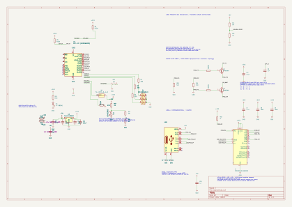
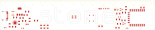

# ESP8266 + CP2102N USB board

This is an independent ESP8266 variant of the USB demo board. It uses an
Ai-Thinker ESP-12F module and one CP2102N USB-to-UART bridge. The original
ESP32 projects are not modified by this variant.

> **Not ready to order.** The routed PCB has no unconnected items or schematic
> parity issues, but two USB connector hole-clearance errors remain.
> Resolve those errors and regenerate matching Gerber, BOM and CPL files
> before ordering. The D1 CPL rotation correction alone is not manufacturing
> approval.

## Project and JLCPCB plugin

Open `board.kicad_pro` with **KiCad 10**. The JLCPCB part assignments are
stored in this variant's `jlcpcb/project.db`; they are separate from the
other board projects.

Use the **[bouni/kicad-jlcpcb-tools](https://github.com/bouni/kicad-jlcpcb-tools)**
KiCad plugin (listed as *JLCPCB Tools*) to generate the manufacturing data
after routing and validation. Generate the Gerbers, BOM and CPL from this
project only, and upload the matching three files together. Do not mix them
with files from `board` or `board_cp2102n`.

The currently assigned JLCPCB parts include:

| Designator | Part | LCSC |
| --- | --- | --- |
| U1 | ESP-12F, 4 MB flash | C82891 |
| U4 | CP2102N-A02-GQFN24R | C969151 |
| USB1 | HC-TYPE-C-16P-01A USB-C connector | C2894897 |
| D1 | ROHM SMLVN6RGB1U1 RGB LED (Extended) | C2909770 |
| R22 | 1 kOhm CP2102N reset pull-up, 1206 | C4410 |
| C11 | 4.7 uF local ESP8266 supply capacitor, 1206 | C29823 |
| IN1 | TS-1187A-B-A-B pushbutton | C318884 |
| TH1 | 10 kOhm NTC, B3950, 0805 | C338623 |
| R23 | 10 kOhm divider pull-up, 1206 | C17902 |
| R24 | 33 kOhm ADC series resistor, 0603 | C4216 |
| R25 | 10 kOhm ADC shunt resistor, 0603 | C25804 |

Confirm live catalog stock, assembly eligibility, footprints, pin 1 and
rotation in JLCPCB's assembly preview before ordering.

### RGB LED assembly rotation

D1 retains the ROHM SMLVN6RGB1U1 and its existing footprint and routing.
In top view, pin 1 (blue anode) is the upper-left pad at the footprint's
current 0-degree board orientation. Pins 2/3 are the red/green anodes;
pins 4/5/6 are the green/red/blue cathodes connected to GND.

The local plugin database contains the exact-value correction
`^SMLVN6RGB1U1$`: **+180 degrees**, with zero X/Y offset. The corrected
`jlcpcb/production_files/CPL-board.csv` therefore exports D1 at **180 degrees**
without rotating its PCB footprint. This compensates for the JLCPCB
orientation shown opposite the board's pin-1 mark in the assembly preview.
Do not also rotate the footprint or apply another 180-degree correction.
Re-upload the corrected CPL and confirm the model's pin-1 marker matches
the upper-left PCB pad before approving assembly.

## Automatic programming

The CP2102N connects to the ESP8266's ROM UART0:

| Signal | Connection |
| --- | --- |
| CP2102N TXD | ESP8266 GPIO3 / U0RXD |
| CP2102N RXD | ESP8266 GPIO1 / U0TXD |
| CP2102N DTR and RTS | Q1/Q2 auto-reset circuit to ESP_EN and GPIO0 |

The DTR/RTS transistor circuit automatically resets the module and selects
the ROM bootloader for normal `esptool` uploads. No manual BOOT or RESET
jumper is needed for routine programming. Keep terminal RTS/CTS hardware
flow control disabled. The board is powered from its USB-C connector.

ESP8266 boot straps must be valid at reset: GPIO0 high for normal flash
boot (low for ROM download), GPIO2 high, and GPIO15 low. R6 pulls GPIO0
high, R13 pulls GPIO2 high, and R12 pulls GPIO15 low. R5 and C6 provide
the EN pull-up and reset timing. R22 is the separate 1 kOhm pull-up on the
CP2102N reset pin, following the Silicon Labs recommendation.

The auto-reset topology matches the esptool control sequence, but uploads
and power-up behavior still require validation on a physical prototype.
ESP8266 EN and RST remain tied together; this placement update does not
change that connection.

## Critical placement and routing

C8 (100 nF) and C11 (4.7 uF) are next to the ESP8266 VCC pin. C11 adds local
bulk capacitance without taking C5 away from the regulator or C7 away from
the USB bridge. C6 (1 uF) is next to the ESP8266 EN/RST pins; Q1/Q2 and their
base resistors have also been moved toward the module.

C1/C9 (100 nF) and C7 (4.7 uF) provide local CP2102N decoupling. R22 is near
its reset pin. C5 (22 uF) remains local to the TLV1117LV output, with C2/C3
and C10 near its input. Use short supply and ground connections; placement
alone does not provide decoupling until the connections are routed.

Preserve the ESP-12F footprint's antenna keepout on both copper layers.
Give the regulator adequate copper for heat dissipation and keep the ADC
and reset traces away from noisy digital routes.

## Firmware connections

| Function | ESP8266 connection | Notes |
| --- | --- | --- |
| RGB red | GPIO12 / D6, through R2 (330 Ohm) | Red anode through current-limiting resistor |
| RGB green | GPIO13 / D7, through R3 (330 Ohm) | Green anode through current-limiting resistor |
| RGB blue | GPIO14 / D5, through R1 (330 Ohm) | Blue anode through current-limiting resistor |
| Digital input | GPIO4 / D2 | Active high; R8 is an external 10 kOhm pull-down |
| Analog input | TOUT / ADC0 / A0 | 10-bit raw value, 0..1023, exposed as `REAL` |
| Recovery input (DA1) | GPIO5 / D1 | Normally open; close DA1 to GND during boot |

The ESP8266 has one external ADC input, TOUT/ADC0. TH1 and its divider
provide the analog signal on A0: R23 and TH1 form the 10 kOhm B3950
thermistor divider, with R24/R25 attenuating and biasing the ADC node. The
nominal ADC voltage at a 3.3 V supply is about 0.344 V with a 10 kOhm
thermistor and 0.623 V if TH1 is open, within the ESP-12F's 0-1.0 V ADC
range. These nominal calculations include the loading from R24/R25.
Firmware reads the A0 channel as a raw 10-bit count (0..1023); convert it to
temperature only if the application requires it. Do not apply 3.3 V or 5 V
directly to TOUT.

DA1 is no longer connected to A0. Its first pad is GPIO5/D1 and its second
pad is GND. Keep DA1 open for normal operation; bridge it to GND while the
ESP8266 resets to select the default application and parameters. Firmware
should enable GPIO5's internal pull-up and sample the recovery input during
boot. IN1 remains the active-high GPIO4/D2 input with its external pull-down.

## Images

These images show a placement/connectivity preview, not a manufacturing
approval.

## Checks and remaining work

KiCad ERC reports **0 errors** and one existing LED-library mismatch warning.
PCB DRC reports **2 existing USB connector hole-clearance errors** and
**0 silkscreen warnings**, with **0 schematic parity issues** and
**0 unconnected items** in the routed board.
The board still needs DRC cleanup, a final JLCPCB assembly preview,
and physical prototype checks of power, automatic programming, Wi-Fi, RGB,
ADC and recovery before production approval.
